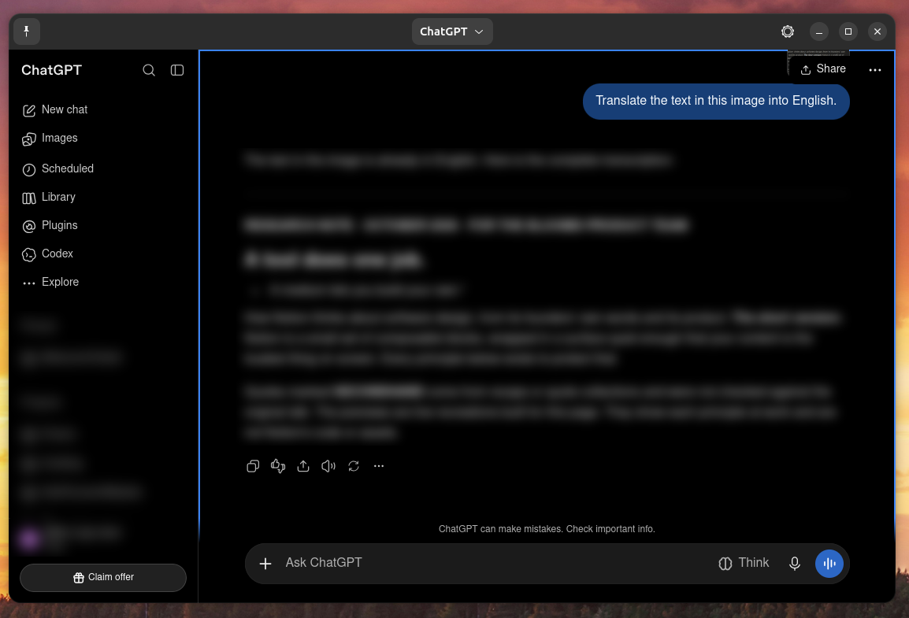
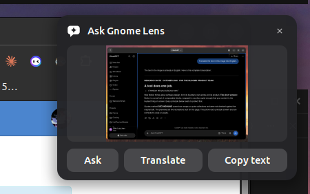
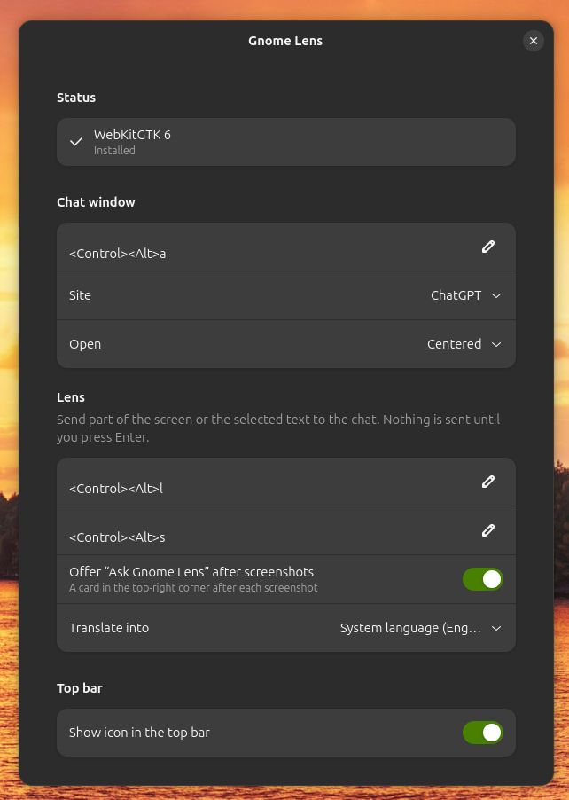

# Gnome Lens

A GNOME Shell extension that opens and closes an **AI chat window** (ChatGPT, Claude or Gemini)
with a keyboard shortcut. You stay logged in, and conversations stay where you left them between
openings: the window is hidden, never reloaded.

- Shortcut: <kbd>Ctrl</kbd>+<kbd>Alt</kbd>+<kbd>A</kbd> by default (changeable in preferences)
- Opens next to the pointer or centered, on the current workspace; remembers its size
- Pinned by default; unpin it (header bar) to hide it when it loses focus
- Site switcher in the header bar; each site keeps its own conversation
- Optional top bar icon with a menu (Show / hide chat, Lens, Preferences)

### Lens: ask about anything on screen
- **After every screenshot** (Print key), a card in the top-right corner offers **Ask**, **Translate** and **Copy text**
- <kbd>Ctrl</kbd>+<kbd>Alt</kbd>+<kbd>L</kbd> opens GNOME's screenshot tool; the area or window you capture goes straight to the chat
- <kbd>Ctrl</kbd>+<kbd>Alt</kbd>+<kbd>S</kbd> asks about the text you've highlighted (or the text or image you copied)

The content is attached to the prompt box of the site you're using, with a ready-made prompt.
**Nothing is sent until you press Enter.** Translations go into your system language (changeable in preferences).

Tested on Ubuntu 26.04 with GNOME Shell 50.1 (Wayland).

## Screenshots

| Chat window | After a screenshot | Preferences |
|---|---|---|
|  |  |  |

## Install

Requires WebKitGTK 6:

```bash
sudo apt install gir1.2-webkit-6.0
```

Then from this repository:

```bash
git clone https://github.com/mikeluigijean/gnome-lens.git ~/scripts/gnome-lens
~/scripts/gnome-lens/install.sh
```

Log out and back in once (Wayland only discovers new extensions at login).

## How it works

GNOME Shell can't embed a web view, so the chat window is a small separate GTK 4 + WebKit 6 app
(`app/`), started on first use and controlled by the extension over D-Bus
(`io.github.mikeluigijean.GnomeLens`). Logins are stored in `~/.local/share/gnome-lens`.
The app quits when the extension is disabled (also on screen lock); logins survive that,
open pages are reloaded on the next opening.

Troubleshooting: `journalctl -f -o cat /usr/bin/gnome-shell` shows both the extension's and the app's messages.

## Development

```bash
gjs -m tests-js/run.js                       # unit tests (lib/)
gjs -m gnome-extension/gnome-lens@mikeluigijean.github.io/app/main.js   # the app alone (after install.sh)
gdbus call --session -d io.github.mikeluigijean.GnomeLens -o /io/github/mikeluigijean/GnomeLens \
    -m io.github.mikeluigijean.GnomeLens1.Toggle
```

`./pack.sh` runs the tests and builds `dist/gnome-lens@mikeluigijean.github.io.shell-extension.zip` for extensions.gnome.org
(notes for reviewers: `docs/review-notes.md`).

## Credits

Inspired by [Screen word translate](https://github.com/sunwxg/gnome-shell-extension-dict)
(MIT); the window placement is ported from it. License: MIT.
